# ЛР 3. HA Postgres Cluster

**Марковник Полина 466635**

## Состав репозитория

| Файл | Назначение |
|---|---|
| `Dockerfile` | образ Postgres 15 + Patroni |
| `docker-compose.yml` | сервисы: pg-master, pg-slave, zoo, haproxy |
| `postgres0.yml`, `postgres1.yml` | конфигурации Patroni для первой и второй ноды |
| `haproxy.cfg` | конфигурация балансировщика |
| `screenshots/` | скриншоты хода работы |

---

## Часть 1. Поднимаем Postgres

Запуск:

```
docker compose up -d --build
```

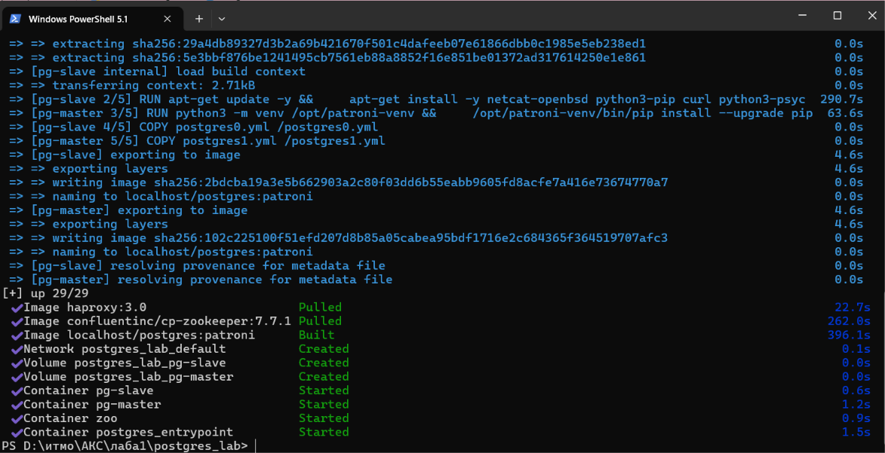

Проверяем, что все контейнеры запущены:

```
docker ps
```

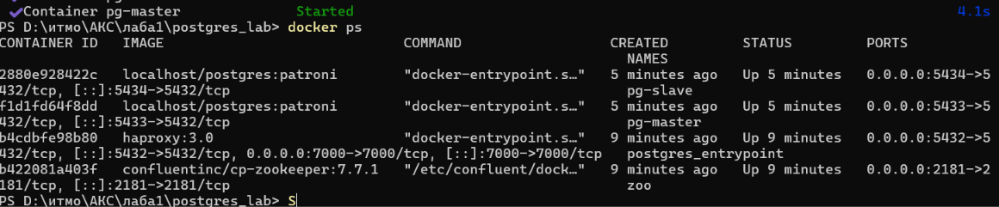

Логи Zookeeper (сервис запустился):

```
docker compose logs zoo
```

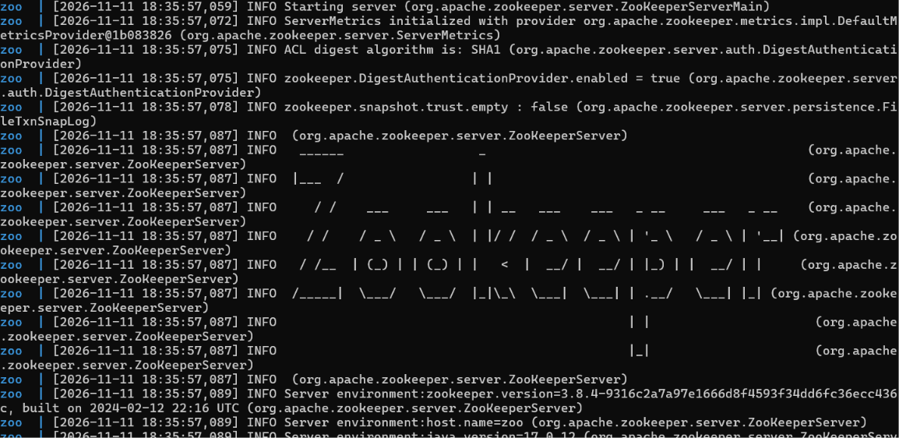

Логи нод Postgres (одна нода стала лидером, вторая — репликой):

```
docker compose logs pg-master
docker compose logs pg-slave
```

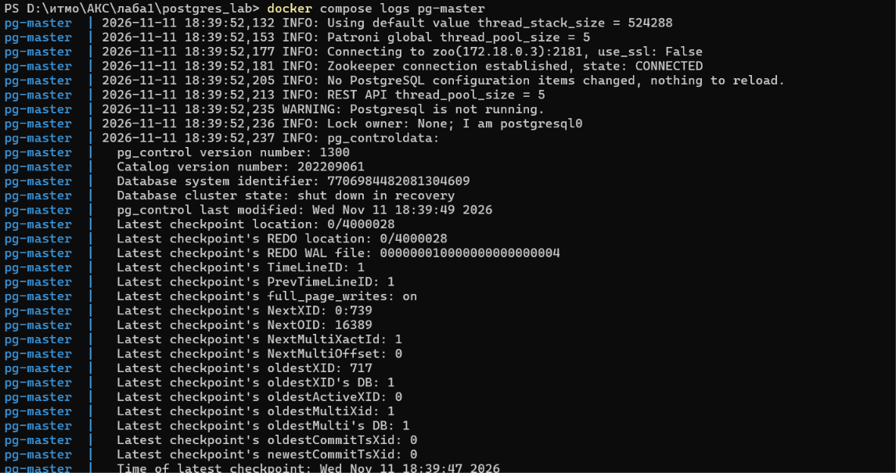
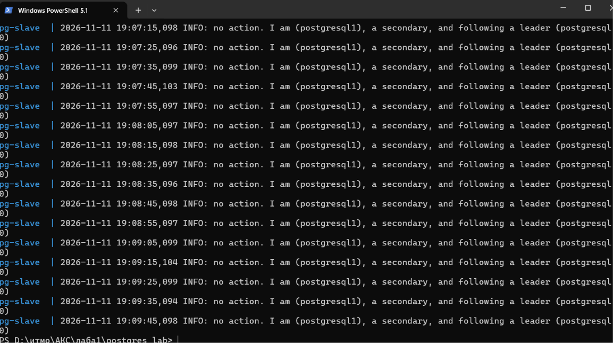

Состав кластера и роли нод:

```
docker exec pg-master patronictl -c /postgres0.yml list
```

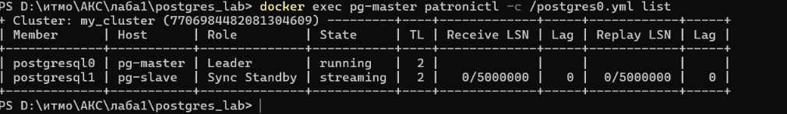

**Лидером кластера стала нода: pg-master**

---

## Часть 2. Проверяем репликацию

Создаём таблицу и добавляем строку на лидере:

```
docker exec -e PGPASSWORD=postgres pg-master psql -h localhost -U postgres -c "CREATE TABLE my_first_replication (id int, my_data varchar, my_comment varchar);"
docker exec -e PGPASSWORD=postgres pg-master psql -h localhost -U postgres -c "INSERT INTO my_first_replication VALUES (1, 'my important data', 'is this line replicated?');"
```

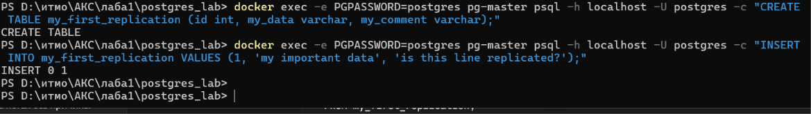

Читаем данные на второй ноде — таблица и строка появились автоматически (streaming replication):

```
docker exec -e PGPASSWORD=postgres pg-slave psql -h localhost -U postgres -c "SELECT * FROM my_first_replication;"
```

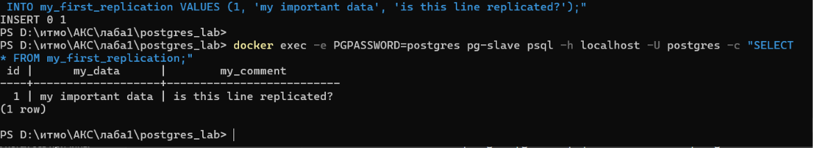

Пробуем записать данные на реплике — получаем ошибку, так как реплика работает в режиме read-only:

```
docker exec -e PGPASSWORD=postgres pg-slave psql -h localhost -U postgres -c "INSERT INTO my_first_replication VALUES (2, 'new important data', 'is this gonna work?');"
```

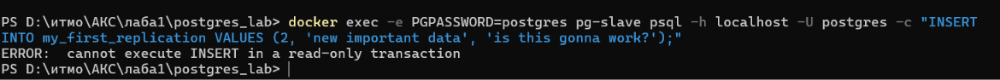

---

## Часть 3. HAProxy

HAProxy добавлен в `docker-compose.yml`, конфигурация — в `haproxy.cfg`. Он опрашивает REST API Patroni на порту 8008 обеих нод и направляет трафик только на ту ноду, которая отвечает кодом 200, то есть на текущего лидера.

Логи HAProxy и состояние контейнеров:

```
docker compose logs haproxy
docker ps
```

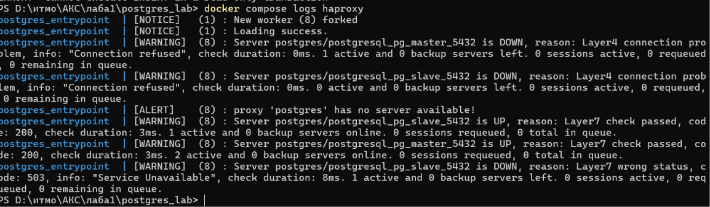

Подключение через единую точку входа (`postgres_entrypoint:5432`):

```
docker exec -e PGPASSWORD=postgres pg-master psql -h postgres_entrypoint -p 5432 -U postgres -c "SELECT * FROM my_first_replication;"
```

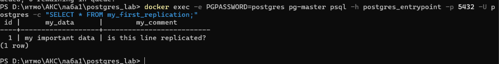

Страница статистики HAProxy (http://localhost:7000): лидер зелёный, реплика красная.

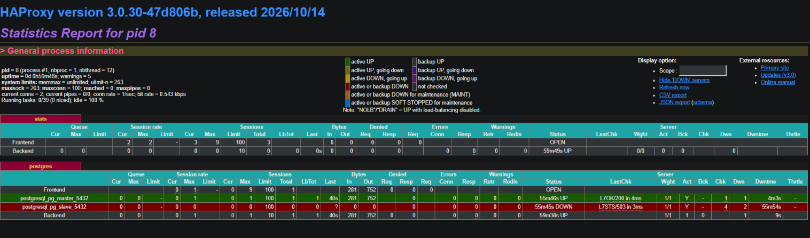

---

## Задание: отключение мастера

### 1. Останавливаем лидера

```
docker stop pg-master
```

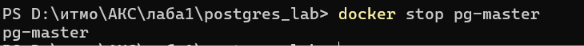

Ждём около 40 секунд и смотрим состояние кластера со второй ноды:

```
docker exec pg-slave patronictl -c /postgres1.yml list
```

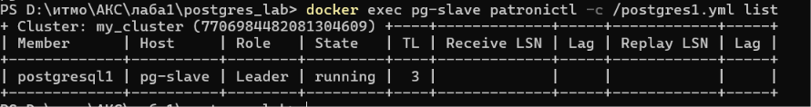

Логи оставшейся ноды (видно, что она стала лидером):

```
docker compose logs pg-slave
```

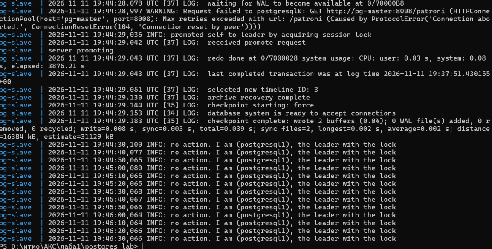

### 2. Читаем и пишем через entrypoint

```
docker exec -e PGPASSWORD=postgres pg-slave psql -h postgres_entrypoint -p 5432 -U postgres -c "SELECT * FROM my_first_replication;"
docker exec -e PGPASSWORD=postgres pg-slave psql -h postgres_entrypoint -p 5432 -U postgres -c "INSERT INTO my_first_replication VALUES (3, 'written while master is down', 'failover test');"
```

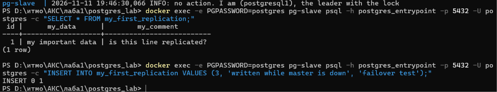

Статистика HAProxy после остановки:

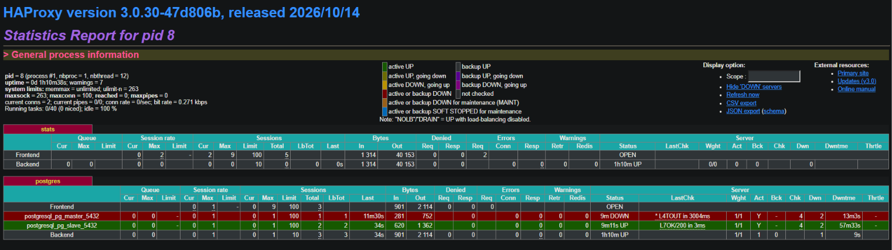

**Получилось прочитать и записать**
### 3. Что произошло

1. После остановки контейнера лидер перестал обновлять свой ключ в Zookeeper. Через время жизни ключа Zookeeper считает лидера недоступным.
2. Patroni на оставшейся ноде увидела, что лидера нет, и повысила свою ноду до primary (promote). В кластере включён `synchronous_mode`, поэтому реплика была синхронной и содержала все подтверждённые данные: потери данных нет.
3. HAProxy каждые 3 секунды проверяет порт 8008 (`inter 3s fall 3`), и после трёх неудачных проверок помечает остановленную ноду как DOWN. Новый лидер отвечает кодом 200, поэтому трафик идёт на него. Поэтому в первые секунды после остановки подключение через entrypoint может не пройти, после переключения всё работает.
4. Запись через entrypoint стала возможной, потому что HAProxy направил её на новую primary-ноду.

### 4. Возвращаем ноду

```
docker start pg-master
docker exec pg-slave patronictl -c /postgres1.yml list
docker exec -e PGPASSWORD=postgres pg-master psql -h localhost -U postgres -c "SELECT * FROM my_first_replication;"
```

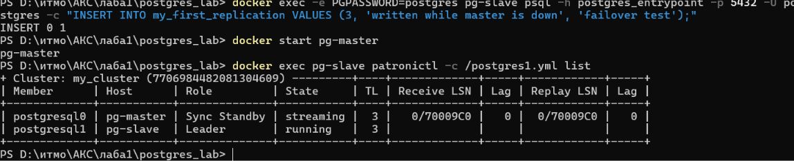
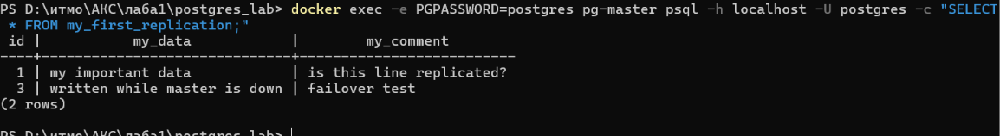

Вернувшаяся нода автоматически подключилась к кластеру как реплика (в конфигурации включён `use_pg_rewind: true`) и получила данные, записанные в её отсутствие.

**Результат: есть.**
